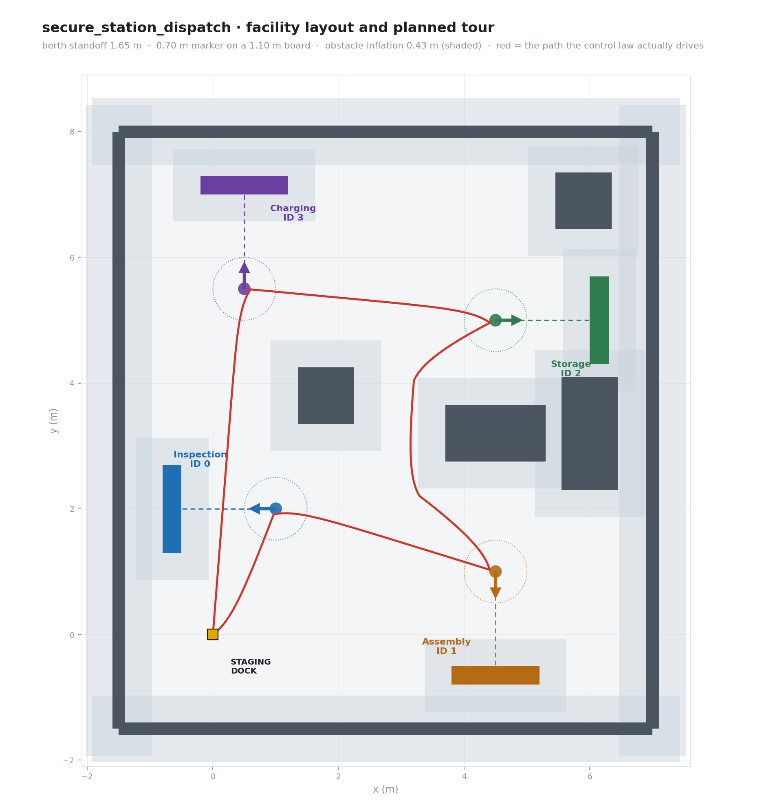

# secure_station_dispatch

**ROS 2 package — AMR station dispatch driven by ArUco fiducials, with HMAC-authenticated
detections and obstacle-aware navigation.**

Tested on ROS 2 Jazzy (Python 3.12) and Humble (3.10) · Gazebo Sim · OpenCV ≥ 4.7

---

An autonomous mobile robot tours a walled facility, berths square-on to each of four
station bays, reads the bay's ArUco marker, authenticates the detection, and executes a
station-specific task through a ROS 2 action — logging every outcome to a JSONL event log.



---

## Contents

| | |
|---|---|
| [Quick start](#quick-start) | Build and run the demo |
| [What each phase adds](#what-each-phase-adds) | Pipeline → security → simulation |
| [Stations and markers](#stations-and-markers) | The registry at a glance |
| [Navigation](#navigation) | Planner, controller, watchdog |
| [Perception](#perception) | Why the geometry is what it is |
| [Security](#security) | HMAC and pose consistency |
| [Testing](#testing) | Three suites, one of them ROS-free |
| [Documentation](#documentation) | Architecture, root cause, runbook |

---

## Quick start

```bash
# Dependencies
sudo apt-get install -y \
    ros-$ROS_DISTRO-ros-gz-bridge ros-$ROS_DISTRO-ros-gz-sim \
    ros-$ROS_DISTRO-cv-bridge ros-$ROS_DISTRO-vision-opencv
pip install opencv-contrib-python pyyaml

# Build
cd ~/ros2_ws
colcon build --packages-select secure_station_dispatch --symlink-install
source install/setup.bash

# Run the full demo
ros2 launch secure_station_dispatch gazebo_demo.launch.py
```

The robot leaves the staging dock, visits all four bays in ID order, and returns. It
prints a per-station report and writes `logs/tour_report.json` and
`logs/dispatch_events.jsonl`.

Faster loops:

```bash
bash test/run_navigation_checks.sh    # ~1 s, no ROS, no Gazebo
bash test/run_gazebo_tour_test.sh     # ~90 s, full stack, no Gazebo
ros2 launch secure_station_dispatch gazebo_demo.launch.py gui:=false
```

Full argument list and troubleshooting: **[docs/runbook.md](docs/runbook.md)**.

---

## What each phase adds

**Phase 1 — the dispatch pipeline.** `marker_detector_node` turns camera frames into
`StationMarker` messages; `dispatcher_node` runs an `IDLE ↔ TASK_IN_PROGRESS` state
machine and acts as the `StationTask` action client; `task_simulator_node` executes
multi-step tasks with progress feedback. Custom `.msg` and `.action` interfaces, a YAML
station registry, and a JSONL event log.

**Phase 2 — authenticating what the camera claims to see.** A printed marker or a forged
ROS message can drive an unsecured facility robot anywhere. Detections are signed with
HMAC-SHA256 under a per-station pre-shared key, and the dispatcher additionally checks
that the robot is physically near the station it claims to be at. Two working attacks
under `attacks/` demonstrate both rejections.

**Phase 3 — making the robot physically get there.** A generated Gazebo facility, a
differential-drive AMR with an 0.85 m sensor mast, and an obstacle-aware scripted tour
with stall detection and recovery.

> Phase 3 originally failed: the robot drove into the Assembly Station's own marker panel
> while departing for Storage, wedged, and finished the tour from a corrupted pose —
> while still reporting success. The layout, the planner, the controller and the reporting
> were all rebuilt around that.
> **[Read the root cause analysis →](docs/root-cause-phase3-collision.md)**

---

## Stations and markers

`config/station_registry.yaml` is the **single source of truth** for station geometry.
The Gazebo world, the navigation planner, the detector and the security checks all read
it, and `scripts/check_world_sync.py` fails if any of them drift apart.

| ID | Station | Task | Berth | Approach | Board centre | Board faces |
|---|---|---|---|---|---|---|
| 0 | Inspection | Inspection (~3.0 s) | `[1.0, 2.0]` | 180° | `[-0.65, 2.0]` | `+X` |
| 1 | Assembly | Assembly (~3.5 s) | `[4.5, 1.0]` | −90° | `[4.5, -0.65]` | `+Y` |
| 2 | Storage | Storage (~2.7 s) | `[4.5, 5.0]` | 0° | `[6.15, 5.0]` | `−X` |
| 3 | Charging | Charging (~3.5 s) | `[0.5, 5.5]` | +90° | `[0.5, 7.15]` | `−Y` |

Each bay carries a three-part sign stack — accent nameplate, matte-white 1.10 m carrier
board with a 0.70 m `DICT_4X4_50` marker, and a charcoal info plate. Regenerate with:

```bash
python3 scripts/generate_marker_boards.py   # prints a detection range sweep
python3 scripts/generate_world.py           # projects the registry into SDF
```

---

## Navigation

`secure_station_dispatch/navigation/` is deliberately ROS-free so the whole tour can be
replayed offline in the test suite.

- **`planner.py`** — every leg is a shortest collision-free polyline over the visibility
  graph of the inflated obstacle corners (A\*, plus a shortcut pass). Two clearance
  layers: a **hard** footprint equal to the robot radius (0.28 m), and a **soft** layer
  adding the safety margin (0.43 m total). A berth may sit inside a soft halo — it has to,
  to read the board — but never inside a hard footprint.
- **`controller.py`** — turn-then-arc pursuit. Heading errors beyond 0.55 rad are turned
  out on the spot rather than arced away, because arcing wide is how a robot cuts the
  corner the planner just routed it around. Linear speed is proportional to range and
  attenuated by heading error, so the robot decelerates into the berth.
- **`StallWatchdog`** — aborts a leg the moment the robot is commanded to move and does
  not (< 4 cm in 3 s). The leg then reverses 0.35 m, turns 0.70 rad and **re-plans from
  the freed pose**, up to three times. Time spent deliberately stationary never counts.

A leg that does not arrive is reported as a failed berth and the node exits non-zero. The
tour never again reports success it did not achieve.

---

## Perception

The detector scores confidence from apparent marker size:

```
confidence = min(marker_perimeter_px / 1200, 1.0)
```

which makes `min_confidence` a **range gate** as much as a quality gate. The facility was
laid out against that, not the other way round:

| Camera range | Marker px | Confidence | Verdict |
|---|---|---|---|
| < 1.33 m | — | — | board clips the frame, detection drops out |
| **1.50 m** | **259** | **0.86** | **accept — this is the berth** |
| 1.72 m | 226 | 0.75 | accept (gate) |
| 1.90 m | 204 | 0.68 | reject |
| 2.50 m | 155 | 0.52 | reject |

A board is therefore legible from its own berth and nowhere else — which is what stops the
robot dispatching a bay it is merely driving past. The maths lives as executable code in
`navigation/perception_budget.py` and is re-derived from the shipped registry on every
test run.

---

## Security

| Attack | Mitigation | Outcome logged |
|---|---|---|
| Forged `StationMarker` published on the topic | HMAC-SHA256 over `marker_id + station_name`, keyed per station | `AUTH_FAIL` |
| Valid signature replayed from the wrong place | `check_pose()` against `expected_pose` ± `pose_tolerance_m` | `LOCATION_MISMATCH` |
| A genuine board read from across the facility | Confidence gate doubles as a range gate | never published |
| The same bay dispatched repeatedly at one berth | Per-marker cooldown after completion | `COOLDOWN` (throttled) |

```bash
# Both attacks, end to end
bash test/run_security_test.sh

# Or individually, against a running dispatcher with enable_security:=true
ros2 run secure_station_dispatch spoof_marker_publish
ros2 run secure_station_dispatch location_mismatch_attack
```

`pose_tolerance_m` (0.5 m) is deliberately wider than the navigation `goal_tolerance_m`
(0.10 m), so a correctly berthed robot can never be rejected as a location mismatch.

---

## Testing

| Suite | Command | Needs | Time |
|---|---|---|---|
| Navigation + perception regressions | `bash test/run_navigation_checks.sh` | nothing | ~1 s |
| Headless dispatch integration | `bash test/run_gazebo_tour_test.sh` | ROS 2 | ~90 s |
| Phase 1 pipeline | `bash test/run_test.sh` | ROS 2 | ~60 s |
| Phase 2 security | `bash test/run_security_test.sh` | ROS 2 | ~30 s |
| Full simulated demo | `ros2 launch … gazebo_demo.launch.py` | ROS 2 + Gazebo | ~2 min |

The ROS-free suite is the one that pins the Phase 3 fix. It replays the entire tour —
planner, control law, watchdog and a unicycle model of the robot — at the node's real
20 Hz rate and checks the footprint against the hard obstacle inflation on every tick:

```
$ bash test/run_navigation_checks.sh
  world / registry synchronisation ....... 12 collision models inside their footprints
  planner + perception regression ........ 17/17 passed
  offline tour simulation ................ 6/6 passed

  tour duration     73.5 s simulated      obstacle contacts   0
  worst berth error 9.9 cm (tol 10 cm)    minimum clearance   0.528 m
```

Two tests exist specifically so the original defect cannot come back:

- `test_original_collision_is_detected_and_routed_around` rebuilds the *old* panel
  geometry and asserts the planner flags the Assembly→Storage line and detours safely.
- `test_watchdog_fires_when_the_robot_is_blocked` drives a simulated robot into a wall and
  asserts the leg aborts well before the segment timeout.

Under `colcon`:

```bash
colcon test --packages-select secure_station_dispatch
colcon test-result --verbose
```

---

## Package structure

```
secure_station_dispatch/
├── config/station_registry.yaml       ← single source of truth
├── msg/StationMarker.msg
├── action/StationTask.action
├── launch/
│   ├── gazebo_demo.launch.py          full simulated demo
│   └── station_dispatch.launch.py     nodes only
├── secure_station_dispatch/
│   ├── marker_detector_node.py        camera → ArUco → StationMarker
│   ├── dispatcher_node.py             state machine, security, cooldown
│   ├── task_simulator_node.py         StationTask action server
│   ├── waypoint_tour_node.py          obstacle-aware scripted tour
│   ├── navigation/                    ROS-free: planner, controller, budget
│   └── security/checks.py             HMAC + pose consistency
├── worlds/industrial_station_world.sdf   ← generated
├── models/materials/textures/            ← generated signage
├── scripts/
│   ├── generate_world.py              registry → SDF
│   ├── generate_marker_boards.py      registry → signage + verification
│   ├── check_world_sync.py            drift guard
│   └── render_facility_map.py         docs figures
├── test/
│   ├── test_waypoint_planner.py       planner + perception regressions
│   ├── test_tour_simulation.py        offline full-tour simulation
│   ├── test_dispatch_pipeline.py      Phase 1 integration
│   ├── test_security_checks.py        Phase 2 integration
│   ├── mock_image_publisher.py        synthetic, pose-aware camera
│   └── run_*.sh                       suite runners
├── attacks/                           spoofing + location-mismatch demos
└── docs/                              architecture, root cause, runbook
```

---

## Documentation

| Document | What it covers |
|---|---|
| **[docs/architecture.md](docs/architecture.md)** | Runtime topology, the registry as source of truth, navigation and perception design, security model, build notes |
| **[docs/root-cause-phase3-collision.md](docs/root-cause-phase3-collision.md)** | The marker-panel collision: timeline, the four defects behind it, the fix, and the tests that pin it |
| **[docs/runbook.md](docs/runbook.md)** | Build, run, verify, regenerate, troubleshoot, tune |
| **[docs/CHANGELOG.md](docs/CHANGELOG.md)** | Release history |

---

## License

MIT — see `LICENSE`.
