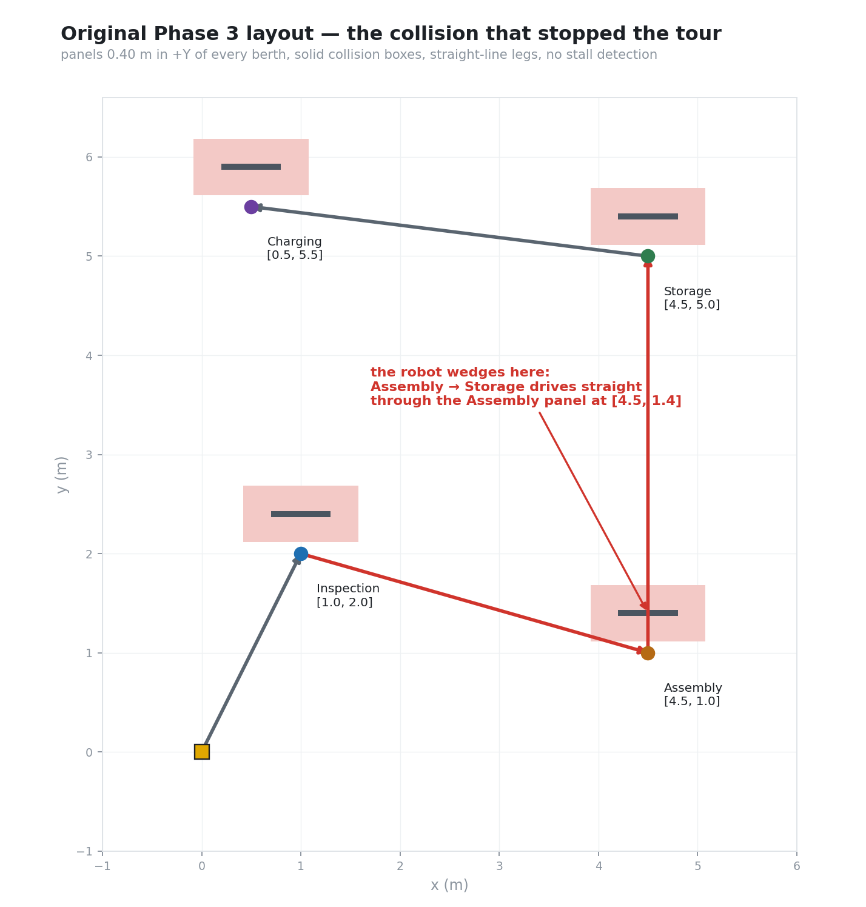

# Root cause analysis — Phase 3 tour halts at the second marker

| | |
|---|---|
| **Reported as** | "The robot collides with the ArUco marker at the second QR and gets stuck." |
| **Component** | `waypoint_tour_node`, `worlds/industrial_station_world.sdf` |
| **Severity** | Demo-blocking. Two of four stations never dispatched. |
| **Status** | Fixed. Pinned by `test/test_waypoint_planner.py` and `test/test_tour_simulation.py`. |

---

## 1. Summary

The tour reached the Assembly Station (marker 1, the second bay visited) and then drove
head-on into that station's own marker panel while departing for Storage. The robot
wedged, kept commanding forward velocity for the full 20 s leg timeout, and then
continued the itinerary from a corrupted pose. No further marker was ever framed, so
Storage and Charging were never dispatched — and the tour still printed
`WAYPOINT TOUR COMPLETE`.

This was not one bug. It was a layout defect, a planning defect, a control defect and a
reporting defect that lined up.



---

## 2. Timeline of the failure

| t | What happened |
|---|---|
| — | Robot berths at Inspection `[1.0, 2.0]`, task completes. |
| — | Leg 2 drives to Assembly `[4.5, 1.0]`. The straight line already clips the Assembly panel's footprint on approach, but only grazes it, so the robot arrives. |
| — | Assembly task completes. |
| **T** | Leg 3 targets Storage `[4.5, 5.0]`. Both berths sit on `x = 4.5`, so the path is a straight run in `+Y` — directly through the Assembly panel at `[4.5, 1.4]`. |
| T+0.5 s | Chassis contacts the panel. `drive_to` sees `dist > tolerance` and keeps publishing `linear.x > 0`. |
| T+20 s | Leg times out. `drive_to` `break`s out of its loop, which is the same exit path as a successful arrival. |
| T+20 s | `rotate_to(π/2)` spins the wedged robot in place against the panel. |
| T+26 s | Tour "arrives", logs an error of ≈3.6 m, and moves on. `/mock_pose` now publishes a pose 3.6 m from where the dispatcher expects it. |
| — | Legs 4 and 5 start from the wedged pose. No marker is ever framed again. |
| — | Tour prints `WAYPOINT TOUR COMPLETE — All stations visited successfully!` |

---

## 3. The four defects

### 3.1 Layout — panels placed inside the driving envelope

Every station panel was placed at `expected_pose + 0.40 m` in `+Y`, with a solid
`<collision>` box spanning `z ∈ [0.10, 0.70]` — squarely in the robot's collision band
(chassis top at `z = 0.225`).

Two berths shared a coordinate: Assembly `[4.5, 1.0]` and Storage `[4.5, 5.0]`. Any
straight line between them passes through `x = 4.5`, and the Assembly panel spans
`x ∈ [4.2, 4.8]` at `y = 1.4`. The collision was structural, not incidental.

Worse, all four panels faced `+Y`, so approaching a bay from anywhere south of it and
then departing north meant driving *through* it.

### 3.2 Planning — no obstacle model at all

`waypoint_tour_node` drove `drive_to(target_x, target_y)` in a straight line between
berths. Nothing in the node knew a single obstacle existed. The world file was the only
description of the facility's geometry, and no code read it.

This is the real root cause: **two descriptions of the same facility, only one of which
the robot could see.**

### 3.3 Control — no stall detection, and a timeout that looked like success

```python
# original drive_to(), condensed
while time.time() - start < timeout:
    ...
    if dist <= dist_tolerance:
        break            # arrived
    ...
    self.cmd_pub.publish(twist)
self.stop_robot()        # both exits land here
```

There was no check that commanded motion produced displacement, so the controller
pushed against the panel for the full timeout. And the timeout exit was
indistinguishable from the arrival exit: both fell out of the loop and returned. The
caller then logged the (large) position error as information and continued.

### 3.4 Perception — the geometry could not have worked anyway

Even without the collision, the demo's detection was marginal. With a 0.60 m marker at a
0.40 m standoff on a 640×480 / 60° camera, the marker projects to ≈830 px per side —
larger than the image. OpenCV's ArUco contour stage discards candidate quads that run off
the frame, so detection drops out entirely. The camera also sat at `z = 0.25 m` while the
panel centre was at `z = 0.40 m`, so the board was framed off-centre.

---

## 4. The fix

### 4.1 One source of truth

`config/station_registry.yaml` now owns all station geometry: berth pose, approach
heading, marker board pose and normal, bay footprint, facility bounds, obstacle list and
navigation tuning.

* `scripts/generate_world.py` **projects** the registry into `industrial_station_world.sdf`.
* `secure_station_dispatch.navigation.obstacles_from_registry()` builds the planner's
  obstacle set from the same file.
* `scripts/check_world_sync.py` fails the build if any collision volume in the world
  escapes a declared footprint, or if a declared obstacle has no geometry behind it.

The two descriptions can no longer disagree, because there is only one.

### 4.2 Re-laid facility

Bays moved to the facility perimeter, each facing inward, at a **1.65 m** berth standoff.
No berth-to-berth straight line now passes through a bay. Berths and headings:

| ID | Station | Berth | Approach | Board centre | Board faces |
|---|---|---|---|---|---|
| 0 | Inspection | `[1.0, 2.0]` | `180°` | `[-0.65, 2.0]` | `+X` |
| 1 | Assembly | `[4.5, 1.0]` | `-90°` | `[4.5, -0.65]` | `+Y` |
| 2 | Storage | `[4.5, 5.0]` | `0°` | `[6.15, 5.0]` | `-X` |
| 3 | Charging | `[0.5, 5.5]` | `+90°` | `[0.5, 7.15]` | `-Y` |

### 4.3 Obstacle-aware planning

`secure_station_dispatch/navigation/planner.py` plans every leg as a shortest
collision-free polyline over the visibility graph of the inflated obstacle corners
(A\*, with a shortcut pass). Obstacles are inflated by
`robot_radius_m (0.28) + safety_margin_m (0.15) = 0.43 m`.

The planner keeps **two** clearance layers. The hard layer is the robot's own radius;
crossing it is a real collision. The soft layer adds the safety margin. A berth may
legitimately sit inside a soft halo — the robot has to get close to read a board — so
obstacles containing the start or goal are forgiven their margin, but never their hard
footprint. Without that distinction the planner would have had to exempt the whole
obstacle and would happily have planned straight through the panel again.

### 4.4 Stall watchdog and recovery

`navigation/controller.py::StallWatchdog` aborts a leg the moment the robot is commanded
to move and does not: less than **4 cm** of displacement in a **3 s** window. The leg then
runs a recovery — reverse 0.35 m, turn 0.70 rad — and **re-plans from the freed pose**,
up to three times. Time spent deliberately stationary (holding a berth) never accumulates
towards a stall.

### 4.5 Honest arrival and reporting

`drive_to_point()` now returns `arrived` / `stalled` / `timeout` as distinct outcomes.
A leg that does not arrive is reported as a failed berth; the station's dispatch is
marked `NOT_ATTEMPTED`, and the node exits non-zero. `logs/tour_report.json` records the
per-station position error, yaw error, recovery count and dispatch outcome.

### 4.6 Perception geometry solved, not guessed

The camera moved onto a **0.85 m sensor mast**, level with the board centres and 0.15 m
ahead of the robot datum. Board and marker sizes were solved against the detector's own
confidence heuristic (`perimeter / 1200 px`):

| Range from camera | Marker px | Confidence | Verdict |
|---|---|---|---|
| < 1.33 m | — | — | board clips the frame, detection drops out |
| 1.50 m (**berth**) | 259 | **0.86** | accept |
| 1.60 m | 242 | 0.81 | accept |
| 1.72 m | 226 | 0.75 | accept (gate) |
| 1.90 m | 204 | 0.68 | reject |
| 2.50 m | 155 | 0.52 | reject |

The gate therefore doubles as a range gate: a board is only legible from its own berth,
which is what stops the robot dispatching a bay it is merely driving past.
`secure_station_dispatch/navigation/perception_budget.py` holds this maths as executable
code, and the test suite re-derives it from the shipped registry on every run.

### 4.7 Duplicate dispatch guard

A berthed robot keeps its board framed for the whole dwell, and the task finishes in
≈3 s. Without a guard the dispatcher returned to `IDLE` and re-dispatched the same
station on the very next frame. Completed markers are now suppressed for
`dispatcher.redispatch_cooldown_s` (20 s), and repeated `IGNORE`/`COOLDOWN` messages are
log-throttled to one per marker per 5 s.

---

## 5. Verification


```
$ bash test/run_navigation_checks.sh

  world / registry synchronisation ...... 12 collision models inside their footprints
  planner + perception regression ....... 17/17 passed
  offline tour simulation ............... 6/6 passed
```

The offline simulation replays the whole tour — planner, control law, watchdog and a
unicycle model of the robot — at the node's real 20 Hz rate, and checks the footprint
against the hard obstacle inflation on **every tick**:

```
tour duration        73.5 s simulated
worst berth error    9.9 cm   (tolerance 10 cm)
worst yaw error      3.33°
obstacle contacts    0
minimum clearance    0.528 m to rack_centre  (0.43 m inflation)
```

Two tests specifically pin this defect:

* `test_original_collision_is_detected_and_routed_around` rebuilds the *old* panel
  geometry and asserts the planner both flags the Assembly→Storage line as blocked and
  produces a detour that never enters a panel's hard footprint.
* `test_watchdog_fires_when_the_robot_is_blocked` drives a simulated robot into a wall
  and asserts the leg aborts well before the segment timeout.

---

## 6. What would have caught this earlier

1. **A single source of truth for geometry.** The defect existed in the gap between the
   world file and the node. Deleting the gap deletes the class of bug.
2. **Distinguishing "timed out" from "arrived."** The tour reported success while
   3.6 m from its target. Any assertion on final position would have failed loudly.
3. **A closed-loop health check.** "Commanded to move, did not move" is cheap to detect
   and catches every variety of collision, not just this one.
4. **Solving the perception geometry on paper.** The 0.40 m standoff could never have
   produced a detection; it was never checked against the camera model.
